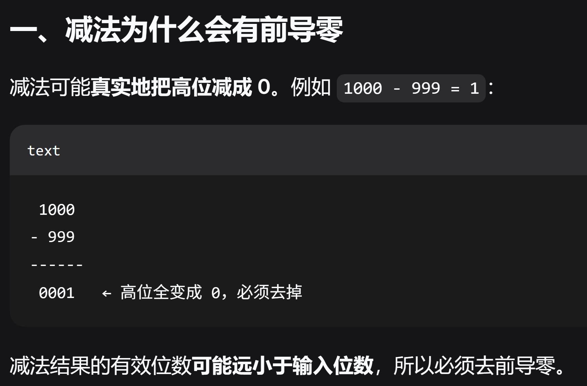
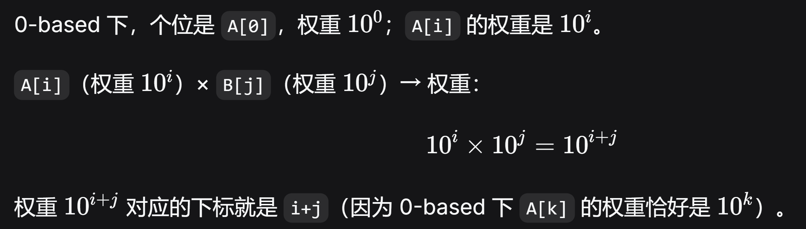

# 高精度
支持**更大整数**间的运算。
方法：运用了一些**算法结构**。

任务：实现一个简单的计算器，A （加减乘除） B 。
- 输入和结果都保证为正（**负数**的基本运算可以**转化为正数**）
- 对于除法，输出商和余数

## 0. 存储
>在平常的实现中，**高精度数字利用字符串表示**，每一个**字符**表示**数字**的一个十进制位．因此可以说，高精度数值计算实际上是一种特别的字符串处理

高精度算法实际上也是一种模拟，只不过**模拟**的是我们**计算加减乘除的过程**。
回忆人类如何计算加减乘除——**列竖式，从最低位算起**。
所以，为了模拟这一计算过程，我们采用**逆序存储**，即**数组首（下标小）** 的地方存储**低位数字**。
也可以说是反转存储。
则**输出也应该是逆序输出。**

## 1. 加法
具体计算过程中还有一件重要的事，就是“**进位**”。

从最低位开始，将两个加数**对应位置**上的数码相加，并判断是否达到或超过 10．如果达到，那么**处理进位**：将更高一位的结果上增加 1，当前位的结果减少 10．

需要注意的地方就是**数字的高低位和下标的关系**：下标小的存低位，是逆序的存储，计算结果也要逆序输出。

具体代码见：[高精度加法模版题-洛谷P1601](../Luogu/P1601.cpp)

## 2. 减法
减法的关键在于“借位”，而且注意我们要用**大 - 小**，如果原式的结果是负数，那就给计算结果加个'-'号（注意，数组存储（模拟）的整数，不能直接乘-1哦）

从个位起逐位相减，遇到负的情况则向上一位借 1．整体思路与加法完全一致.

具体代码见：[高精度减法模版](../Luogu/bignum_sub.cpp)

*为什么需要去前导零：

## 3. 乘法

### a. 大 × 小
直接将 𝑎 每一位上的数字乘以 𝑏

关注乘数 𝑏 的范围．若它和 10^9（或相应整型的取值上界）属于同一数量级，那么需要慎用高精度—单精度乘法

注意，不符合十进制表示法，所以不能简单-10，而要用除以 10 的商和余数计算

代码：[bignum_mul.cpp](../Luogu/bignum_mul.cpp)

### b. 大 × 大
两个数都是高精度，就用竖式乘法。

对于**结果的第 k 位**，它可能由 a[0] * b[k]、a[1] * b[k-1]、……、a[k]*b[0] **共同贡献**。

所以最后统一用循环来处理进位。

**ai × bj 过程可以用两层循环**，乘出来的数应该放在 **i+j（0-base）** 的位置。

有些下标上的数可能会要进位，把进位加到 i+1 上。

*也需要去前导零

代码：[高精度加法模版题-洛谷P1303](../Luogu/P1303.cpp)

## 4. 除法
竖式长除法可以看作一个**逐次减法**的过程
